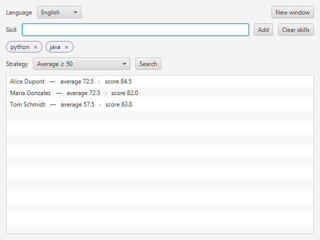

# CV Search

[](https://github.com/tvallot/cv-search/actions/workflows/ci.yml)

A small JavaFX desktop app that filters and ranks job applicants by skill.

You enter the skills you are looking for, pick a selection rule, and get the
matching applicants sorted by score. Applicants are plain YAML files in
[`data/applicants/`](data/applicants).



## Features

- Four selection rules: every skill ≥ 60, average ≥ 50, at least one skill ≥ 90,
  at least 5 years of experience on each skill
- A score that adds work experience to the skill level (years on the skill,
  weighted by company)
- English and French interface, switchable at runtime; all open windows follow
- Clear error messages for malformed applicant files

## Running it

Requires JDK 21. Maven is downloaded by the wrapper.

```bash
./mvnw javafx:run          # Windows: mvnw.cmd javafx:run
./mvnw verify              # unit tests + checkstyle + coverage report
```

To use another set of applicants:
`./mvnw javafx:run -Djavafx.args="path/to/folder"`.

An applicant file looks like this:

```yaml
name: John Smith
skills:
  c: 90
  java: 50
experience:
  Google:
    start: 2005
    end: 2010
    keywords: [c, java]
```

## How it's built

Java 21, JavaFX, SnakeYAML, JUnit 5, Hamcrest, Checkstyle, JaCoCo, GitHub Actions.

The code follows MVC. Selection rules use the Strategy pattern, so adding a
rule means adding one class. Views only talk to a `SearchController`
interface. See [docs/DESIGN.md](docs/DESIGN.md) for the details.

```
src/main/java/io/github/tvallot/cvsearch/
├── model/            applicants, YAML loading, score computation
│   └── strategy/     selection rules
├── controller/       runs a search and sorts the results
├── view/             JavaFX window
└── i18n/             current language and translations
```

## Limits

Ranking people with a formula is easy to get wrong. The company weights in
`CompanyFactors` are arbitrary and favour applicants from large tech companies,
and a skill missing from a CV counts as zero. The app is a coding exercise and
should not be used for real hiring decisions.

## Background

This started as a team project with Alexandre Delort for the Software
Engineering course of the Master's in Computer Science at Université Claude
Bernard Lyon 1, on top of a skeleton provided by the teaching staff. I later
reworked it for this repository: refactored the model, fixed bugs, added tests
and translated the codebase to English.
