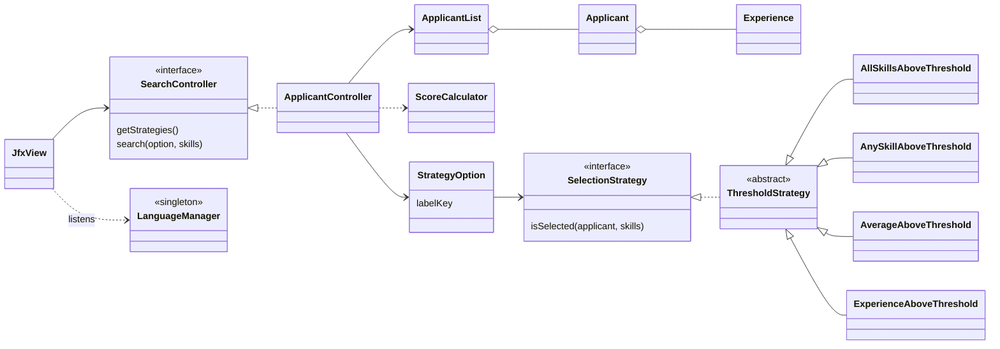

# Design notes

## Overview

## A search, step by step

1. The window keeps the searched skills in a list and lets the user pick a `StrategyOption`.
2. On "Search", it calls `SearchController.search(option, skills)`.
3. `ApplicantController` asks the strategy whether each applicant is selected, then
   computes the average level and score with `ScoreCalculator`.
4. It returns `SearchResult` records sorted by score, then by name. The window only
   formats them.

## Choices

**Strategy for selection rules.** The rules only differ in how they test an applicant,
so each is a small class implementing `SelectionStrategy`. The four current rules all
compare a number to a threshold, so they share `ThresholdStrategy`, which checks that
the threshold is not negative. The list of rules on offer lives in the controller,
paired with a translation key (`StrategyOption`), so that the model knows nothing
about the interface language.

**"No skill" means "all skills".** Searching with an empty list evaluates each
applicant on their own skills. This rule is in one place, `Applicant.skillsToEvaluate`,
instead of being repeated in each strategy.

**The view depends on an interface.** `JfxView` only knows `SearchController`, which
makes the controller replaceable and testable without JavaFX. The controller and model
do not import JavaFX at all, so the unit tests run headless.

**Several windows, one state.** "New window" opens another `JfxView` on the same
controller. The language is held by the `LanguageManager` singleton, which notifies
the windows when it changes (observer). Every window then refreshes its texts, so they
always show the same language.

**Builders for loading data.** `ApplicantBuilder` turns one YAML file into an
`Applicant`, and `ApplicantListBuilder` does it for a whole directory. Malformed files
fail with a message that names the file and the problem, instead of a
`ClassCastException`.

## Score

For each searched skill: `level + Σ(years on the skill × company factor)`, then
averaged over the searched skills. A skill the applicant doesn't list counts as 0. The
company factors (`CompanyFactors`) are 2.0 for a few big tech companies, 1.2 for a few
consulting firms, and 1.0 otherwise.
